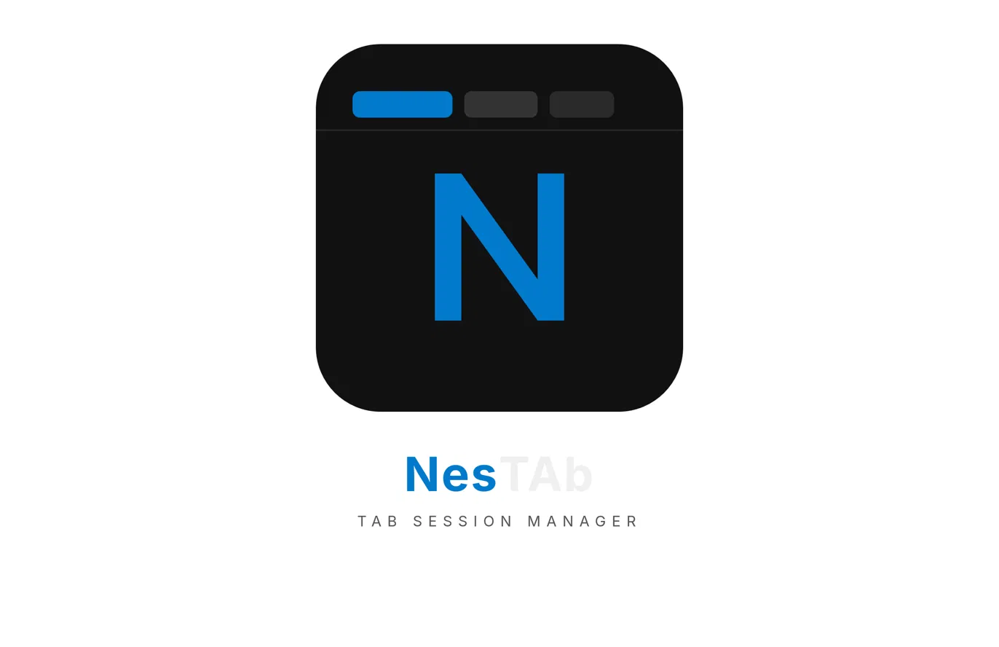

<div align="center">



# NesTAb

**Save, manage and restore your browser tab sessions**

[](LICENSE)
[](manifest.json)
[]()
[]()

*Built for people who live with too many tabs open.*

<br/>

<!-- Replace with your actual GIF -->


</div>

---

## Why NesTAb?

Every browser session turns into tab chaos. You're afraid to close tabs because you'll lose them. So they pile up, eating RAM, slowing everything down.

NesTAb fixes that. Save your tabs into named sessions, close them guilt-free, and bring them back whenever you need them.

---

## Features

| | Feature | Description |
|---|---|---|
| 💾 | **Save sessions** | Save all or selected tabs into a named session |
| ✅ | **Selective saving** | Pick exactly which tabs to save before closing |
| ↗️ | **Restore sessions** | Reopen every tab from a saved session instantly |
| ✏️ | **Edit sessions** | Rename or remove individual tabs from any session |
| ✕ | **Close matching tabs** | Close open tabs that belong to a saved session |
| ⚡ | **Close all tabs** | Clear the window, open a fresh tab, see RAM freed |
| 🛡️ | **Safe deletions** | Every destructive action asks for confirmation |
| 💽 | **Persistent storage** | Sessions survive popup close and browser restarts |

---

## Demo

> Record a GIF using [ScreenToGif](https://www.screentogif.com/) and replace `demo.gif` above

---

## Install

### Chrome
```bash
1. Go to chrome://extensions
2. Enable Developer mode (top right toggle)
3. Click Load unpacked → select the nestab folder
```

### Opera
```bash
1. Go to opera://extensions
2. Enable Developer mode (top right toggle)
3. Click Load unpacked → select the nestab folder
```

---

## How to use

**1. Save a session**
Click the NesTAb icon → click **Save Session** → name it → select tabs → confirm

**2. Manage sessions**
Each saved session has four action buttons:

| Button | Action |
|--------|--------|
| ✏️ Pencil | Edit session name and tab list |
| ↗️ Restore | Reopen all saved tabs in new tabs |
| ✕ X | Close currently open tabs matching this session |
| 🗑️ Trash | Delete the session permanently |

**3. Free up RAM**
Click **Close All Tabs** to clear your window instantly and see how much memory was freed.

---

## Screenshots

<div align="center">

<!-- Add your screenshots here -->
| Save Session | Manage Sessions |
|---|---|
|  |  |

</div>

---

## Tech stack

- HTML · CSS · Vanilla JavaScript
- Chrome Extension Manifest V3
- `localStorage` for session persistence
- Google Material Symbols (outline) via CDN

---

## Roadmap

- [ ] Cloud sync across devices
- [ ] Auto-save session on window close
- [ ] Search through saved sessions
- [ ] Keyboard shortcuts
- [ ] Firefox support

---

## License

MIT © 2026 — Built for personal use, free for everyone.

---

<div align="center">

Made with focus by a developer tired of tab chaos.

⭐ Star this repo if NesTAb saves your RAM

</div>
